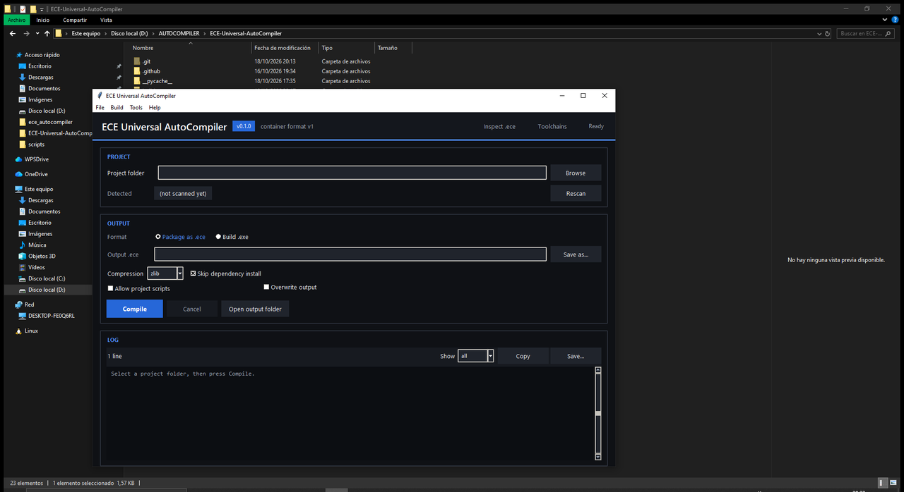

<div align="center">

# ECE Universal AutoCompiler

**Windows-only build tool: detects a project's technology, runs its real build
with the toolchain installed on your PC, packages the result into a secure,
versioned `.ece` container — or exports the project to a standalone Windows
`.exe`.**

*From a desktop window or the command line — no third-party Python packages.*

[What's new](#whats-new-in-12-new-visuals-and-useful-tools) · [Features](#features) · [Quick start](#quick-start) · [The `.exe`](#standalone-windows-app-exe) · [CLI](#command-line) · [Docs](#documentation) · [Honest by design](#honest-by-design)

<p align="center">
  
</p>

</div>

---

> **Status: 1.2, Windows 10/11 x64 only.** What runs **for real**:
> Python and Node.js `.ece` builds, Python `.exe` export (PyInstaller), and —
> when the toolchain is installed — native `.exe` builds for C#/.NET, Rust, Go
> and C/C++. Everything else is *detected* and *reported* with an install hint;
> nothing about a missing toolchain is ever faked.

---

## What's new in 1.2: New visuals and useful tools

This is the current release. It is about telling you **what this tool can actually
do on your PC** instead of letting you find out by failing:

- **The real desktop window, in the README.** The screenshot at the top is an
  actual capture of the shipped GUI: a dark, card-based window with a project
  badge, output mode and a live colour-coded log.
- **Export readiness before you try.** `analyze` (and the desktop **Detect**)
  answers "can this become an `.exe` here?" per candidate, with the exact next
  step when the answer is no: `analyze --json` carries a per-candidate
  `exe_readiness` object.
- **Failures in a fixed shape.** Build and `.exe` errors are reported as
  *what happened / why / what to do* — in the CLI, in the window, and in the
  build history — never as a single opaque line.
- **Windows path-collision guard for `.ece`.** The writer refuses to create
  paths Windows treats as the same file, the extractor refuses *before writing
  any byte*, and the validator only warns. Existing containers stay readable.
- **Verified release builds.** `scripts\build_exe.ps1` builds a frozen desktop
  app and a frozen console app, then `tools\release_check.py` runs them for
  real (`--version`, launch probe), recording size and SHA256 in
  `dist\release.json`. A build that cannot run fails the script and is never
  called a release.
- **Troubleshooting that names the real paths.**
  [docs/TROUBLESHOOTING.md](docs/TROUBLESHOOTING.md) covers antivirus/SmartScreen,
  missing toolchains, and where logs and history actually live.

### Planned next — 40 usability improvements

[New visuals and useful tools](docs/NEW_VISUALS_AND_USEFUL_TOOLS.md) is the
working plan for the next release: copyable install commands
(`winget`/`choco`/`scoop`/URL) whenever a toolchain is missing, a first-run
assistant, a build-plan preview, `.ece` comparison, a `doctor` command, and a
**build-time bar** that estimates and reports elapsed/remaining time from your
own local history.

That document is a **plan, not a claim**: each item ships only when its stated
verification passes. Everything always stays on your machine
(`%LOCALAPPDATA%\ECE-Universal-AutoCompiler\` — config, history, logs, cache).

---

## Features

- **Detects** a project's type from manifests, marker files, directory shape and
  source extensions — Python, Node/TypeScript, .NET, Rust, Go, Java/Maven,
  Java/Kotlin/Gradle, C/C++ (CMake/Make/Meson), PHP, Unity, Unreal.
- **Plans** a build using argument lists (never a shell string), drawing on real
  toolchain discovery on the machine.
- **Runs** the build with timeouts, cancellation, output capture and secret
  redaction. Steps that execute project-controlled code (for example
  `npm install` or an npm build script) require **explicit consent**.
- **Packages** the collected artifacts into an `.ece` container with a JSON
  manifest, a per-file index, per-file SHA-256 hashes and a package content hash.
- **Validates** and **safely extracts** containers (path-traversal, symlink and
  depth checks; hashes verified before a file replaces its target).
- **Diagnoses** build failures by classifying output into actionable categories.
- **Reports readiness before you try**: `analyze` answers, per detected
  project, whether *this* PC can produce an `.exe` and exactly what is missing.
- **Ships verified builds**: `scripts\build_exe.ps1` runs each artifact it
  produces — a build that cannot run is never called a release.

## Quick start

**Option A — portable `.exe` (no Python needed).** See
[The `.exe`](#standalone-windows-app-exe) below, then open it, pick a folder and
press **Compile**.

**Option B — run from source.** Install it once in editable mode, so the
command works from **any folder** (recommended):

```powershell
python -m pip install -e .
python -m ece_autocompiler --version
python -m ece_autocompiler gui        # open the desktop window
```

Or run it without installing, **only from the repository root** (`PYTHONPATH`
set anywhere else fails with `No module named ece_autocompiler`):

```powershell
# From the repository root
$env:PYTHONPATH = "$PWD\src"
python -m ece_autocompiler gui
```

## Standalone Windows app (`.exe`)

You do **not** need Python installed to *use* the tool. Build a single, portable
executable once, then just open it, select a project folder and press
**Compile**:

```powershell
# One-time: build the executables (needs pyinstaller)
powershell -ExecutionPolicy Bypass -File scripts\build_exe.ps1                  # both builds, single file
powershell -ExecutionPolicy Bypass -File scripts\build_exe.ps1 -Layout onedir  # folder (faster start)
powershell -ExecutionPolicy Bypass -File scripts\build_exe.ps1 -Target cli     # console build only
# -> dist\ECE-AutoCompiler.exe        desktop window (no console)
# -> dist\ECE-AutoCompiler-cli.exe    the same CLI, from a terminal
```

Double-click `dist\ECE-AutoCompiler.exe` to launch the desktop window. The
`.exe` bundles the Python interpreter and the app; nothing else to install.

The console build is the product's command line, frozen: 

```powershell
dist\ECE-AutoCompiler-cli.exe --version
dist\ECE-AutoCompiler-cli.exe analyze C:\path\to\project
dist\ECE-AutoCompiler-cli.exe exe C:\path\to\project -o C:\out\app.exe
```

Every build is verified before it is called a release: `tools\release_check.py`
runs the console build (`--version`) and starts the desktop build to confirm it
stays alive, then reports size and SHA256 for each artifact in
`dist\release.json`. A build that cannot run fails the script.

> The build is reproducible via `scripts\build_exe.ps1` (PyInstaller). The
> generated `.exe` files are build artifacts and are **not** committed to the
> repository (see `.gitignore`).

## Desktop window

```powershell
python -m ece_autocompiler gui
```

A single window with a dark theme, laid out as cards:

* **Header** — app name, version chip, and quick buttons for **Toolchains** and
  **Inspect / Extract `.ece`**.
* **Project** — pick the folder (type auto-detected; the result appears as a
  badge) with a **Rescan** button.
* **Output** — choose **Package as `.ece`** or **Build `.exe`** (detects the
  language); the output path and options adapt to the mode. The **Compile**
  button is the prominent one; **Cancel** and **Open output folder** sit next
  to it.
* **Log** — colour-coded build output.

Options per mode — `.ece`: compression, skip install. `.exe`: single file or
folder layout, console window. Shared: allow project scripts (consent),
overwrite output.

Menus: **File** (open output/work folder), **Tools** (Inspect / Extract `.ece`…,
Toolchains…, Build history…), **Help** (About).

## Command line

```powershell
python -m ece_autocompiler analyze  path\to\project
python -m ece_autocompiler build    path\to\project -o out\project.ece --consent
python -m ece_autocompiler exe      path\to\project -o out\app.exe --name app
python -m ece_autocompiler validate out\project.ece --deep
python -m ece_autocompiler validate out\project.ece --verify-signature
python -m ece_autocompiler inspect  out\project.ece
python -m ece_autocompiler extract  out\project.ece out\unpacked --overwrite
python -m ece_autocompiler tools
```

`build` refuses to run project scripts unless `--consent` is passed.

## Turn code into an `.exe`

The `exe` command **scans your project, detects the language, and compiles it
with that language's own toolchain** into a Windows executable:

```powershell
python -m ece_autocompiler exe path\to\project -o out\app.exe --name app
```

| Detected language | How the `.exe` is made |
| --- | --- |
| **Python** | PyInstaller bundles the entry point + interpreter into one `.exe` (**verified**). |
| **C# / .NET** | `dotnet publish -c Release -r win-x64 --self-contained`. |
| **Rust** | `cargo build --release` → `target/release/*.exe`. |
| **Go** | `go build -o app.exe`. |
| **C/C++ (CMake/Make)** | CMake/Make build → locates the produced `.exe`. |
| Node.js / Unity / Unreal | Detected and reported; these need a bundler or their engine (not faked). |

If the required compiler is missing, the tool **says so** with an install hint
instead of pretending to build. Options: `--entry`, `--onedir`, `--console`,
`--name`, `--timeout`. See [docs/SUPPORTED_PROJECTS.md](docs/SUPPORTED_PROJECTS.md).

### `.exe` layout: `onefile` vs `onedir`

The Python exporter and the app builder (`scripts\build_exe.ps1 -Layout ...`)
offer both layouts; the GUI exposes them as *Single file* / *Folder*:

| | onefile (single file) | onedir (folder) |
| --- | --- | --- |
| What you ship | One `.exe` | A folder with the `.exe` + its DLLs |
| Startup | Slower (unpacks to a temp dir first) | Fast |
| Antivirus false positives | More common | Less common |
| Command | `exe ... ` (default) | `exe ... --onedir` |

**Recommendation:** `onedir` for distribution (faster, fewer AV false
positives), `onefile` for convenience. Both produce a **Windows x64**
executable that runs without Python installed. Note that C#/.NET also honours
the choice (`PublishSingleFile`), while Rust, Go and C/C++ toolchains already
produce a single `.exe`, so the folder layout does not apply to them.

## Tests

```powershell
python run_tests.py            # unit + integration + GUI smoke
python run_tests.py unit
python run_tests.py integration -v
python run_tests.py smoke      # GUI only; skips without a display
```

Integration tests create throwaway projects and run **real** Python and Node
builds (Node tests skip automatically when Node is absent).

## Supported projects

See [docs/SUPPORTED_PROJECTS.md](docs/SUPPORTED_PROJECTS.md) for the full matrix
of detection, which builds actually run, and which adapters are detection-only
when a toolchain is missing.

## Troubleshooting

Most problems are one of these three, and each has a short answer:

| Symptom | Cause and fix |
| --- | --- |
| Antivirus flags or deletes a freshly built `.exe` | False positive on a self-extracting build: use `-Layout onedir`, exclude only the build folder, then report it to the vendor. |
| "Cannot build a `<language>` .exe: missing `<tool>`" | A real toolchain is not installed. `analyze <folder>` says what this PC can build; nothing is ever faked. |
| Extraction refused, or "file already exists" | The tool never overwrites silently: pass `--overwrite`, or the container's names collide on Windows. |

Full guide, with the real paths for logs and history:
[docs/TROUBLESHOOTING.md](docs/TROUBLESHOOTING.md).

## Requirements

- **Windows 10/11 x64** — the only supported platform.
- **To run from source:** Python 3.10–3.12 (development only). The built
  `.exe` bundles the interpreter, so end users do **not** need Python.
- **No third-party Python packages.** The standard library only. The GUI uses
  Tkinter, which ships with CPython on Windows.
- Toolchains are optional and only needed for the languages you actually build
  (e.g. Node.js + npm for Node projects, PyInstaller for `.exe` export).

## Honest by design

- If a compiler or SDK is missing, the build **fails with the reason**; the tool
  never reports success it did not achieve.
- An adapter for a missing tool is **detection-only** in that environment. Its
  requirement report says `ready = false` with an install hint.
- `.ece` is a **documented container, not a self-executing format**. Hashes
  detect corruption; they are **not** a publisher signature. A publisher may
  add an optional external signature (minisign/cosign/gpg) that is checked
  only with `validate --verify-signature` / `extract --verify-signature`; a
  missing tool or key is a warning, never a fake "verified". See
  [docs/ECE_FORMAT.md](docs/ECE_FORMAT.md) and [docs/SECURITY.md](docs/SECURITY.md).

## Project layout

```
src/ece_autocompiler/
  container/     .ece spec, codec, writer, reader, validator, path safety
  extraction/    safe extractor
  detection/     markers, toolchain discovery and project detection
  adapters/      build adapter interface + Python/Node + tool-gated adapters
  build/         subprocess runner + orchestrator + history
  diagnostics/   build-output classification
  security/      filename/path helpers for the UI and CLI
  ui/            Tkinter desktop interface
examples/        runnable sample projects (Python, Node)
docs/            architecture, format, security, supported projects, troubleshooting, dev guide
tests/           unit, integration and GUI smoke tests (unittest)
scripts/         build_exe.ps1 (release build) + lint.ps1
tools/           lint_stdlib.py (stdlib-only lint) + release_check.py (verifies a build)
```

See [docs/ARCHITECTURE.md](docs/ARCHITECTURE.md) for how the pieces fit.

## Documentation

- [Architecture](docs/ARCHITECTURE.md) — how the components fit together.
- [ECE format](docs/ECE_FORMAT.md) — the `.ece` container specification.
- [Security](docs/SECURITY.md) — threat model, limits and consent model.
- [Supported projects](docs/SUPPORTED_PROJECTS.md) — detection/build matrix.
- [Troubleshooting](docs/TROUBLESHOOTING.md) — antivirus/SmartScreen, missing
  toolchains, log and history paths, container errors.
- [Development](docs/DEVELOPMENT.md) — setup, tests, building the `.exe`.
- [Release notes 0.1.0](docs/RELEASE_NOTES_v0.1.0.md) — what changed, ready to
  paste into a GitHub release.
- [New visuals and useful tools](docs/NEW_VISUALS_AND_USEFUL_TOOLS.md) — what
  release 1.2 ships and the 40-item usability plan for the next one.

## Contributing

Issues and pull requests are welcome. See [CONTRIBUTING.md](CONTRIBUTING.md) and
[SECURITY.md](SECURITY.md) (please report vulnerabilities privately).

## License

[MIT](LICENSE) — free to use, modify and redistribute.
