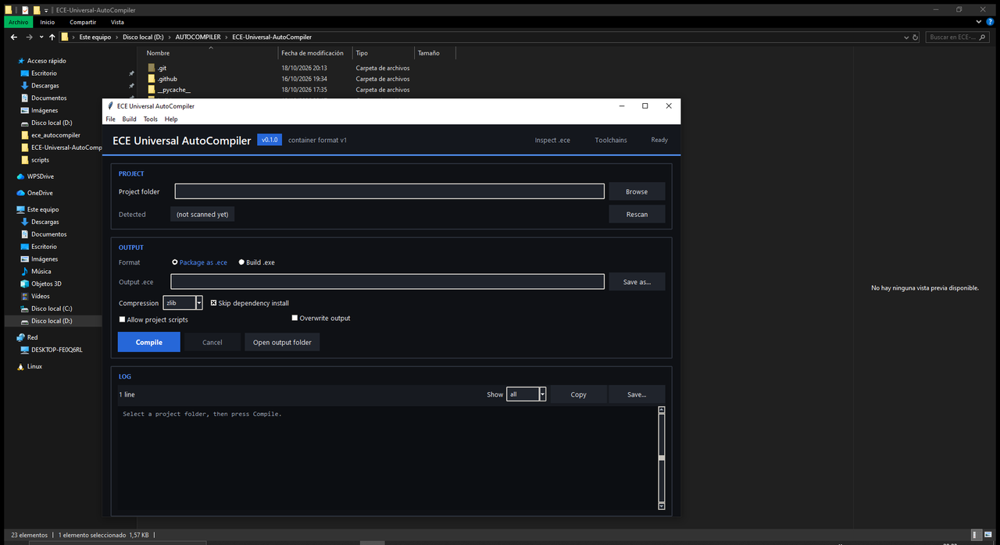

# ECE Universal AutoCompiler

**One Windows desktop application (and CLI) to detect, build, package, analyse,
decompile and rebuild software projects.**

- Original mission: find a project's technology, run its real build with the
  toolchain installed on your PC, and package the result as a versioned `.ece`
  container or a standalone Windows `.exe`.
- New in 1.3: an integrated **DECOMPILER** workspace — universal format
  detection, modular decompilation backends, a reconstructed-project explorer,
  a source editor, an ECE-aware extractor and a real recompilation pipeline —
  inside the same window, with the same navigation and theme.

<p align="center">
  
  <br>
  <sub>Compiler workspace. This capture is from release 1.2; the 1.3 window keeps
  it and adds the DECOMPILER tab (no screenshot has been published for it yet).</sub>
</p>

---

## Overview

ECE Universal AutoCompiler is a standard-library Python application with a
Tkinter desktop interface and a full command-line interface. It is honest by
design: when a toolchain or a backend is missing, it says so and names the
exact next step instead of pretending to succeed.

Two workspaces live in the same window:

| Tab | What it does |
| --- | --- |
| **COMPILER** | Detect a project, preview the plan, run its real build, package `.ece` / `.exe`, inspect containers, package distributables, repair failed builds, compare optimized builds and fuse multi-language workspaces. |
| **DECOMPILER** | Import files by button or drag-and-drop, identify their format, analyse them safely, decompile with the available backend, explore the reconstructed project, edit recovered source, export it and recompile it with a real toolchain. |

Nothing imported into the decompiler is executed. Analysis and decompilation
read bytes and metadata only.

## Current version

**1.3.0** — application release. The `.ece` container format remains
**version 1** and is unchanged by this release.

## Verified technology stack

- **Language:** Python 3.10+ (verified on CPython 3.12).
- **GUI:** Tkinter/ttk from the standard library, custom dark theme.
- **Runtime dependencies:** none. The base application uses the standard
  library only.
- **Optional decompiler extras:** `pefile` (richer PE resources/version info)
  and `capstone` (disassembly), installed with `pip install -e .[decompile]`.
- **Optional external tools (never bundled):** ILSpy `ilspycmd` for C#,
  `javap` for Java listings, and the compilers used by recompilation
  (`dotnet`, `javac`, `mvn`, `gradle`, `python`, `cmake`, `make`, `go`,
  `cargo`, `npm`).
- **Packaging:** PyInstaller for the Windows `.exe`.
- **Tests:** `unittest` (unit, integration and GUI smoke).

## Installation

### From source (recommended for development)

```powershell
git clone https://github.com/garbanzos223-web/UNIVERSAL-COMPILER.git
cd UNIVERSAL-COMPILER
python -m pip install -e .
# optional but recommended for the decompiler:
python -m pip install -e ".[decompile]"
```

Run the desktop application:

```powershell
python -m ece_autocompiler gui
# or: ece-autocompiler gui
# or: python launcher_gui.py
```

Run the CLI:

```powershell
python -m ece_autocompiler --version
python -m ece_autocompiler formats
```

### Prebuilt executable

Release builds are produced by [`scripts\build_exe.ps1`](scripts/build_exe.ps1)
and verified by [`tools\release_check.py`](tools/release_check.py). The
generated files are:

- `dist\ECE-AutoCompiler.exe` — desktop application (no console window)
- `dist\ECE-AutoCompiler-cli.exe` — console/CLI build

`dist` is a build artifact and is not committed; download a release asset or
build it yourself.

## System requirements

- Windows 10 or Windows 11, x64 (the GUI and the built executables are
  Windows-only; the Python package itself can be imported elsewhere).
- Python 3.10 or newer when running from source.
- Free disk space for the projects you build and for recovered projects.
- The toolchains required by the project you want to build or recompile. The
  application detects them and reports what is missing.

## Usage guide

### Compiler workspace (existing functionality)

1. Choose a project folder.
2. Press **Rescan**; the detected technology, evidence and `.exe` readiness are
   reported in the log.
3. Choose **Package as .ece** or **Build .exe**, set the output path and options.
4. Optionally preview the exact plan (**Preview plan**) before running anything.
5. Press **Compile**. Long work runs on a background thread; the log, progress
   and status bar report real milestones.

Other compiler features are available from the menus: container inspection and
extraction, distributable packaging, the fusion workspace, toolchain discovery,
build history, automatic repair, optimization comparison and the environment
doctor.

### Decompiler workspace (new in 1.3)

1. Open the **DECOMPILER** tab (or `Ctrl+2`).
2. Add files/folders, or drag them from Explorer onto the window.
3. The format is identified automatically; press **Analyze** for a full report.
4. Press **Decompile**. A reconstructed project is written to a new folder and
   shown in the **Project** and **Resources** tabs.
5. Double-click a recovered text file to edit it in the integrated editor. Save,
   Save As, search, compare with the recovered original and automatic backups
   are available.
6. **Export project...** writes the reconstructed project to the folder you
   choose.
7. **Recompile project** builds a new binary from the recovered source with the
   real toolchain, then verifies that the artifact exists.

The CLI exposes the same workflows:

```powershell
# identify and analyse without writing a project
python -m ece_autocompiler decompile C:\path\app.exe --analyze-only

# reconstruct a project
python -m ece_autocompiler decompile C:\path\lib.dll -o C:\work\lib-recovered

# show the recompilation commands and run nothing
python -m ece_autocompiler recompile C:\work\lib-recovered --plan

# rebuild and verify
python -m ece_autocompiler recompile C:\work\lib-recovered -o C:\work\rebuilt

# list supported formats
python -m ece_autocompiler formats
```

## Supported formats

Full detail: [docs/SUPPORTED_FORMATS.md](docs/SUPPORTED_FORMATS.md).

| Input | Identification | Analysis | Source recovery | Recompilation |
| --- | --- | --- | --- | --- |
| Windows PE `.exe` / `.dll` | PE header, machine, subsystem | Sections, imports, exports, resources*, strings, PDB, signature presence, disassembly** | **Not possible** (native source is gone); pseudocode is not invented | No (analysis only) |
| .NET assembly (PE + CLR) | CLR data directory, ECMA-335 metadata | Types, methods, runtime metadata, resources | **C# via ILSpy** when `ilspycmd` is installed; otherwise a generated class outline | Yes, with the .NET SDK, from decompiled source |
| Java `.class` | `CAFEBABE`, class-file version | Constant pool, fields, methods, descriptors, source-file attribute | Named class outline; `javap` listings when a JDK exists | Yes when real `.java` sources exist and a JDK is installed |
| Java `.jar` / `.war` | ZIP + `.class` entries | Archive index, class models, `javap` listings | Class outlines + resources; Java sources are extracted unchanged if present | Yes when the archive ships real sources (Maven/Gradle/javac plan) |
| Python `.pyc` | CPython magic, version | Imports, names, signatures, complete `dis` listing | Structural module outline (bodies omitted, clearly marked) | Only from real `.py` sources; outlines are refused |
| PyInstaller application | `MEI` CArchive cookie | Embedded archive TOC | CArchive + PYZ extracted; frozen modules reconstructed as outlines and bytecode listings | Only if real sources are recovered |
| ECE `.ece` | `ECE` magic, format v1 | Manifest, index, verified extraction | Payload extracted by the application's own hardened extractor; sources recovered when present | Yes when the container holds real sources |
| ZIP / TAR / GZIP / BZIP2 / XZ | Magic bytes | Safe listing | Extracted with path/size limits | Only when real sources are present |
| C, C++, C#, Java, Python, Go, Rust, JS/TS, PHP source | Extension + content | Structure/encoding | Used as-is | Yes when the toolchain and build files exist |
| 7z / RAR and other unknown formats | Signature/extension | Identification only | No bundled extractor | No |

\* Resources need `pefile`; ** disassembly needs Capstone or `objdump`.

**Universal format detection** is based on magic bytes first (PE, ELF, CLR,
`CAFEBABE`, pyc magic, `MEI`, `ECE`, ZIP, TAR, gzip, bzip2, xz), with the file
extension only as a last hint. Every analysis records a SHA-256 digest and lists
the operations that are actually available.

## Compilation workflow

```
detect project → rank candidates → toolchain check → plan (dry run available)
    → consent for project scripts → run real build → collect artifacts
    → write .ece / .exe → validate → record history + SHA-256 sidecar
```

Missing toolchains stop the plan with an install hint; a missing tool is never
reported as a successful build.

## Decompilation workflow

```
import → detect format → bounded analysis → select backend
    → write reconstructed project (source / outline / disassembly / resources)
    → project explorer + editor → export
```

Every recovered file carries a status:

- **recovered source** — real source file recovered unchanged or decompiled
  into compilable source;
- **partial reconstruction** — source-like output missing original parts;
- **generated** — an outline, pseudocode or disassembly generated from
  metadata, never claimed to be the original source;
- **extracted resource** — binary/data extracted unchanged;
- **unsupported** — identified but not recoverable by this build.

## Recompilation workflow

```
recovered project → detect project kind → verify sources and toolchain
    → plan (exact argv) → consent when project scripts run
    → execute → verify artifact exists → report size, path, log
```

Recompilation creates a **new** binary. Original signatures, AssemblyInfo,
compiler options and binary layout are not preserved, and native C/C++ binaries
cannot be restored to their original source at all. Full detail and supported
kinds: [docs/RECOMPILER.md](docs/RECOMPILER.md).

## Application architecture

```
ui (Tkinter) ── cli (argparse)
   │                │
   └──── decompiler ├────── build ────── packaging
         │          │         │              │
         │          │         ├── detection  ├── repair
         │          │         ├── adapters   └── optimize
         │          │         └── container / extraction
         │          └── decompiler backends:
         │              dotnet, java, python, native PE, ELF, ECE, archive
         └── TaskRunner (worker threads; results marshalled to Tk)
```

- `src/ece_autocompiler/decompiler/` — format detection, bounded readers
  (`pe`, `elf`, `dotnet_metadata`, `java_class`, `python_bytecode`,
  `pyinstaller`, `archive`), backends, service, recompiler.
- `src/ece_autocompiler/ui/decompiler_panel.py` — the integrated tab.
- `src/ece_autocompiler/ui/editor.py` — syntax-highlighted multi-tab editor.
- `src/ece_autocompiler/ui/dnd.py` — native Windows file drops.

See [docs/ARCHITECTURE.md](docs/ARCHITECTURE.md) for the full package map.

## Project structure

```
src/ece_autocompiler/     application package
  adapters/               per-language build adapters
  build/                  process runner and build orchestrator
  container/              .ece format writer/reader/validator
  decompiler/             analysis, backends, service, recompiler
  detection/              project and toolchain detection
  extraction/             hardened .ece extractor
  packaging/              distributable formats
  repair/, optimize/      repair and optimization engines
  ui/                     Tkinter interface
tests/unit|integration|smoke/
docs/                     user and developer documentation
scripts/                  build and lint scripts
tools/                    release verification and stdlib lint
```

## Build instructions

```powershell
# onefile desktop + console builds, then real launch/CLI verification
powershell -ExecutionPolicy Bypass -File scripts\build_exe.ps1

# a faster-start folder layout
powershell -ExecutionPolicy Bypass -File scripts\build_exe.ps1 -Layout onedir

# only one target
powershell -ExecutionPolicy Bypass -File scripts\build_exe.ps1 -Target gui
powershell -ExecutionPolicy Bypass -File scripts\build_exe.ps1 -Target cli
```

The script installs PyInstaller only if it is absent, builds from
`launcher_gui.py` / `launcher_cli.py`, then runs `tools\release_check.py`. A
bundle that cannot start fails the script and is never called a release.
`dist\release.json` records the size and SHA-256 of each artifact.

## Testing instructions

```powershell
python run_tests.py            # unit + integration + GUI smoke
python run_tests.py unit
python run_tests.py integration
python run_tests.py smoke
powershell -File scripts\lint.ps1
```

The integration tests perform real builds and skip only when the required
toolchain is absent. The decompiler tests build their fixtures with the standard
library (a real `.pyc`, a valid class file, ELF/CArchive/PYZ structures, an
`.ece` container) and never execute an imported binary. See
[docs/TESTING.md](docs/TESTING.md).

## Compatibility and limitations

- GUI and release executables target Windows 10/11 x64.
- The `.ece` format is unchanged at version 1; older containers remain readable.
- Native PE/ELF binaries cannot be decompiled to original source. The tool
  reports real imports, exports, sections, symbols, strings, resources and
  disassembly, and does not fabricate C/C++ code.
- Java source recovery without a dedicated Java decompiler is a named outline,
  not original source.
- Python 3.12 bytecode is reconstructed structurally, not as exact source.
  Cross-version `.pyc` files are identified and their instruction listing is
  reported only when the running interpreter can read them.
- Generated outlines are marked **not recompilable**; the recompiler refuses
  them rather than producing a binary that is not the original application.
- Recompiled binaries are new builds and are not byte-identical to the input.
- No unbundled external tool is downloaded automatically. ILSpy installation is
  an explicit, consented action in the UI.

## Security

- Imported files are **never executed**; readers are bounded and fail safely.
- `.ece` extraction reuses the existing hardened extractor: path traversal,
  Windows path collisions, symlinks, depth and size limits are rejected before
  writing.
- Archives are extracted with path/size checks; absolute paths and `..` entries
  are skipped.
- Build and recompilation commands are argv lists with `shell=False`, a timeout
  and cancellation; project-defined scripts require explicit consent.
- Analysis records SHA-256 digests. Hashes are integrity checks, not signatures.
- Optional tools run with your privileges. Review the displayed command before
  consenting.

Report vulnerabilities privately as described in [SECURITY.md](SECURITY.md).

## Contributing

Contributions are welcome. Read [CONTRIBUTING.md](CONTRIBUTING.md). The two
non-negotiable rules are: never fake a build/decompilation result, and keep the
base runtime standard-library only.

## Changelog

See [CHANGELOG.md](CHANGELOG.md). Release 1.3.0 adds the integrated decompiler,
the source editor, the recompiler and the universal format analysis.

## License

MIT — see [LICENSE](LICENSE).

## Links

- Repository: <https://github.com/garbanzos223-web/UNIVERSAL-COMPILER>
- Issues: <https://github.com/garbanzos223-web/UNIVERSAL-COMPILER/issues>
- Documentation index: [docs/](docs/)
  - [Installation](docs/INSTALL.md)
  - [Supported formats](docs/SUPPORTED_FORMATS.md)
  - [Decompiler](docs/DECOMPILER.md)
  - [Recompiler](docs/RECOMPILER.md)
  - [Architecture](docs/ARCHITECTURE.md)
  - [Development](docs/DEVELOPMENT.md)
  - [Testing](docs/TESTING.md)
  - [Troubleshooting](docs/TROUBLESHOOTING.md)
  - [ECE format](docs/ECE_FORMAT.md)
